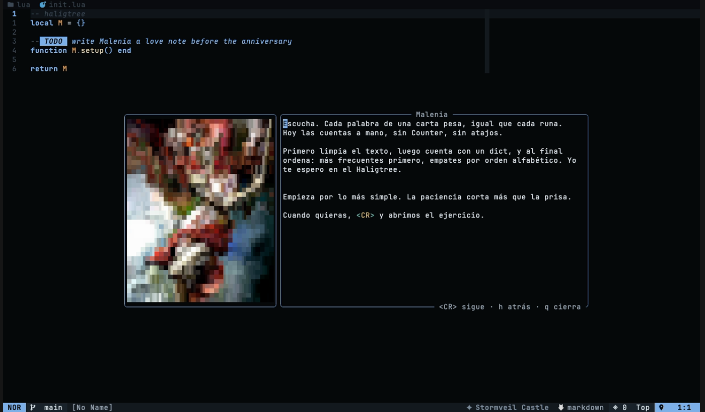

# back-to-basics

Daily coding drills in your terminal, forged by Claude to fit you and graded by real tests.

AI made writing code fast and remembering how to write it optional. This is the gym: you solve by hand, every day. Claude is not the one solving; it is the coach that measures you, draws your path and forges each exercise for where you are today.


- **Nothing fixed.** There is no static exercise list. Claude forges exercises from your aptitude: the concepts you own, the ones that cost you and how your last rounds went.
- **Trusted before you see it.** Every exercise Claude forges is run first: its reference must pass the tests and its starter must fail them. When one does not hold, Claude gets the failure and fixes it, or it is thrown away.
- **A path drawn for you.** A placement test of rising difficulty tells Claude where you really are, and it draws your levels from there. Each level up, it redraws what comes next with the new evidence.
- **Every path ends at an onsite.** The last 2 levels of every track are interview levels: multi part problems like the ones in an Amazon, Zillow or Capital One loop, over realistic data, with edge cases and complexity limits the tests enforce.
- **Node, React, Python and LLM apps at the base, any language on top.** `btb learn rust` has Claude work out how to run Rust tests on your machine. You approve the commands before anything runs.
- **LLMs on Amazon Bedrock, by hand.** The `llm` track drills the Converse API with boto3, streaming, tool use, pydantic validated output, backoff, RAG, evals and agents. Bedrock is faked with botocore's `Stubber`, so it needs no AWS account and costs nothing. It opens once half of your Python path is done, so you get there with the language in hand.
- **Spaced review, without busywork.** Clean solves come back in 3, 7 and 21 days, struggles come back tomorrow. A review of something you already solved shows up as a recap in `btb today` (what it was, its concepts, how it went) instead of asking you to send the same solution again. Only exercises you skipped and never solved go back in the queue.
- **AI only after the fight.** `btb review` has Claude grade your solution once the tests pass.
- **Editor friendly.** Every command takes `--json`, progress goes to stderr.

## Getting started

You need Node 22+ and the [Claude Code](https://claude.com/claude-code) CLI signed in (`claude -p` must work). The `python` and `llm` tracks also need Python 3.10+ with `venv`.

```sh
git clone <this repo> back-to-basics
cd back-to-basics
npm link                  # puts `btb` on your PATH, or run `node bin/btb.js`
btb placement node        # Claude measures you and draws your Node path
btb placement react       # same for React (installs its test packages once)
btb placement python      # Python (installs pytest, pydantic and boto3 in a venv once)
btb placement llm         # LLM apps on Bedrock, once half of the Python path is done
btb                       # today's plan
```

## A day of practice

```sh
btb               # the recap of what is due, then the new exercises per track
btb next          # opens the next one, Claude forges it if it does not exist yet
# edit workspace/<track>/<exercise>/solution.js (or .jsx, .py) in your editor
btb test          # tries the tests, nothing is recorded
btb submit        # runs the tests and records the round
btb hint          # stuck? each hint costs XP
btb skip          # not today: it returns tomorrow and unlocks the reference
btb reveal        # compare with the reference once solved or skipped
btb review        # Claude reviews your solution once solved
btb forge         # forge ahead of time so tomorrow's next opens instantly
```

The pass that ends the day brings its summary: how many you solved, how many clean, what you skipped, failed submits, hints and the concepts worth another look. A round is **clean** when you pass with no hints and at most one failed submit. A level is passed by solving its target number of exercises clean.

## Learning any language

```sh
btb learn go --goal="backend services at a big tech company"
# Claude proposes how to check and run Go tests on your machine, and shows the commands
btb setup go --yes        # you approve them, btb proves them with a tiny sample
btb placement go          # then the same loop as any track
```

If the toolchain is missing, `setup` tells you what to install. If the commands do not work, `btb learn go --again` has Claude rewrite them with the errors in hand.

## Commands

| Command | What it does |
|---|---|
| `btb today` | Today's queue, streak and XP. The default. |
| `btb next [--more]` | Opens the next pending exercise, forging it when needed. `--more` adds one. |
| `btb start <id>` | Opens a specific exercise (`node/group-by-key` or just `group-by-key`). |
| `btb test [id]` | Runs the tests without counting an attempt: the round, the clock and the schedule stay as they are. |
| `btb submit [id]` | Runs the tests against your solution and records the round. |
| `btb hint [id]` | Reveals the next hint. None during placement. |
| `btb skip [id]` | Leaves it for tomorrow and unlocks its reference. |
| `btb reveal [id]` | Prints the reference solution, once solved or skipped. |
| `btb review [id] [--again]` | Claude reviews your solution, once solved. The review is kept, `--again` asks for a new one. |
| `btb greet [--again]` | The coach of the day greets you with how the last session went and what comes today, kept for the day. |
| `btb debrief` | The coach of the day closes the day naming each exercise and how it went. |
| `btb prepare` | Gets the coach's day ready ahead: her greeting and her lines for every exercise in today's queue. |
| `btb recall <id> [--answer="..."]` | Your coach answers what you remembered of the question that closes the lesson: what you got right, what is missing and the key idea. A blank answer gets the answer back. |
| `btb placement [track] [--restart]` | Probes of rising difficulty, then Claude draws the path. |
| `btb path [track] [--redraw]` | The path Claude drew, with the reason it starts where it does. |
| `btb forge [track] [--count=n] [--lessons]` | Forges exercises for the current level ahead of time. `--lessons` writes the lessons older exercises are missing. |
| `btb learn <language> [--goal=...] [--again]` | A new track for any language. |
| `btb setup [track] --yes` | Approves a learned language and proves its toolchain. |
| `btb lessons [track]` | Every lesson forged so far, with your solution and Claude's review when they exist. |
| `btb lesson [id]` | The lesson behind an exercise. |
| `btb brief [id] [--again]` | The coach presents the lesson in their voice, kept for next time. |
| `btb redo <id> [--fresh]` | Solve it again from the starter. Your first solution and your schedule stay as they are. |
| `btb submit <id> --redo` | Grades the redo. |
| `btb status` | Levels per track, XP, streak, mastery. |
| `btb plan` | When each level lands at your pace, and how your goals look. |
| `btb list` | Everything forged and where you stand on it. |
| `btb persona [name]` | The coach in use, or another one. `list` shows them all. |
| `btb persona new <name> --from="..."` | Claude drafts a new coach from a description. |

## Lessons to come back to

Every exercise Claude forges comes with a `lesson.md`: the concept behind it, a small example on a different problem, the typical mistakes and a question to think about. It never solves the exercise. `btb lessons` is the library: what you fought, its lesson, your solution and Claude's review, which is kept the first time you ask for it. `btb redo <id>` puts a fresh starter in `workspace/<track>/<id>/redo/` for when you want to prove you still have it, without touching your first solution, your XP or the spaced review. Exercises forged before lessons existed get theirs with `btb forge --lessons`, which also writes the coach's lines for every exercise of her franchise that has none from her yet.

## A coach beside you

Set `"persona": "claire"` and Claire Redfield keeps you company: she greets you on `btb`, reacts to every submit, hint and skip, and Claude writes `btb review` in her voice. The scores stay as honest as without her. Malenia and Ada Wong come bundled too, and `--persona=malenia` (or `--persona=none`) switches for a single run. btb never picks the coach on its own: whoever calls it (your editor config, say) names the coach of the day, and btb gets everything ready with her in mind. Claire, Malenia and Ada carry `"partner": true`, the only coaches who share the soft romance with you. Any other character can coach a day too: `--persona=leon-s-kennedy --character="Leon S. Kennedy" --franchise="Resident Evil"` has Claude summon them the first time, true to the games and with no romance, borrowing the world of the partner who lives in the same franchise, and keeps them in `.btb/personas/` for every day after. In Neovim, `persona` can return `{ id, character, franchise }` for that.

A persona is a JSON file in `personas/`: a `name`, a `voice` that the reviewer reads, an optional `portrait` and lines per language for each moment (`greet`, `ready`, `failed`, `failed_again`, `passed_clean`, `passed_struggled`, `hint`, `skip`, `level_up`, `debrief`). An optional `world` names the persona's franchise, its `supporting` characters, its `places` and its `lore`, the scenes of each character's own story keyed by name (Leon with the attache case and the merchant, Rebecca mixing herbs, Melina turning runes into levels). The persona is then your partner in every exercise and 3 supporting faces drawn from her world get a role, never from another franchise. One of them, or the persona herself, leads the exercise: the statement is told from a scene of that character's story and works the way it works in the games, and the soft romance stays a touch between the two of you. Each exercise forged with a persona also brings her line for every moment of it (opening it, failing, failing again, buying a hint, skipping, passing clean or with a fight), so she talks about that exercise instead of a generic line, and a level up or the end of the day add theirs after it. Each coach keeps her own lines per exercise. `btb greet` has the coach of the day greet you with how the last session went and what comes today, `btb debrief` closes the day naming each exercise and how it went, both written by Claude once per day and coach. `btb prepare` gets her day ready ahead: her greeting and her lines for every exercise already in today's queue. An optional `texts` per language says the CLI's and the editor's own messages in her voice (`goNext`, `allDone`, `working_next`, `stage_start`...), and `btb persona new` drafts them too. While a persona is set, the progress lines say she is the one forging, drawing and reviewing. Claire lives in Resident Evil and Malenia in Elden Ring, so an editor that passes the persona of the day keeps each day in one world, and new exercises forged for the other franchise wait until it comes back. Lines may use `{title}`, `{xp}`, `{time}`, `{level}` and `{hints}` (hints left, so a line that offers one is only said when there is one to give), filled from the round that just happened, and a line whose placeholders the round cannot fill is skipped. `btb persona new rennala --from="the Queen of the Full Moon, a patient teacher"` has Claude draft one into `.btb/personas/` for you to read and tweak. With `--json` the line comes in `persona` (`id`, `name`, `portrait`, `moment`, `line`) so an editor can show it its own way.

## Configuration

`btb.config.json` at the repo root (or the file `$BTB_CONFIG` points to):

| Key | Default | Meaning |
|---|---|---|
| `language` | `"es"` | Language of the CLI and of everything Claude writes: `es` or `en`. |
| `flavor` | `"js"` | `"ts"` forges TypeScript exercises for Node and React. Node strips the types, no build step. |
| `tracks` | `["node", "react"]` | Bundled tracks, in path order: `node`, `react`, `python`, `llm`. Tracks from `btb learn` are added after them. |
| `dailyNew` | `2` | New exercises per day, shared by the tracks in turns. One per track (`4` with every bundled track) keeps each one moving daily. |
| `dailyReviews` | `3` | Reviews per day at most. |
| `daysPerWeek` | `6` | Practice days a week, used by `btb plan`. |
| `dailyGoalXp` | `40` | The XP you aim for each day. |
| `cleanMaxFailures` | `1` | Failed submits that still count as a clean round. |
| `placementSize` | `5` | Probes in a placement test. |
| `forgeBatch` | `2` | Exercises forged per call, the extra ones wait for the next day. |
| `forgeRetries` | `2` | Times Claude may fix an exercise that failed validation. |
| `theme` | `""` | What test data should be about, passed to Claude as is. |
| `fromBasics` | `false` | Rebuild from the very basics: every new path starts at level 1, the placement goes from returning a value to a loop with an if, and the first two levels are a guided warm up (one idea per exercise, the steps written in the starter, 3 or 4 tests, the warm up example as the quality bar). |
| `cast` | `null` | `{ "leads": [...], "supporting": [...] }`: the leads appear in every exercise, and 3 supporting characters drawn at random get a role in each statement and its test data. Only used when the persona has no `world`. |
| `persona` | `""` | The coach that reacts to your rounds and voices `btb review`, `claire` or `malenia` for example. Empty for none. |
| `testTimeoutMs` | `15000` | Kills a run that takes longer, an infinite loop for example. |
| `workspace` | `"workspace"` | Where your solutions live. Ignored by git. |
| `dataDir` | `".btb"` | Progress, paths, forged exercises and runtimes. Ignored by git. |
| `claude.command` | `["claude", "-p"]` | Any command that reads a prompt on stdin and prints the answer. |
| `claude.timeoutMs` | `300000` | How long one Claude call may take. |
| `goals` | `[]` | `{ "title", "track", "level", "by": "YYYY-MM-DD" }`, checked by `btb plan`. |

## Neovim

This repo is also a Neovim plugin (0.10 or newer). Point lazy.nvim at your clone:

```lua
{
  dir = "~/code/back-to-basics",
  name = "back-to-basics",
  event = "VeryLazy",
  opts = {},
}
```

`<leader>kk` starts the lesson: the coach takes the stage with today's plan, briefs the next exercise in their voice (Claude writes the briefing ahead of time, so it opens instantly) and opens it with its statement on the right. Saving the solution runs the tests. A failure opens with the coach's line on top of it. A pass shows a notification with the XP it paid and the coach's comment on how it went, and takes you straight to the next exercise: the coach briefs it on the stage, or sums up the day when it was the last one (that last comment goes on the stage, the notification keeps the XP). `auto_advance = false` keeps you where you are, `advance_ms` is how long the pass stays on screen before the stage opens and `notice_ms` how long its notification lasts. One message per moment: the statement opens on the right with no summary on top, and the coach speaks either on the stage, inside a report, in a notification or in the corner, never twice. Completion is off in solution buffers, AI suggestions included, because you are here to fight by hand. When the next new exercise is not forged yet, the plugin has Claude forge it and brief it in the background, off the screen so the statement stays readable. Only a failure shows up.


Pass the persona of the day (a function in `persona`) and each day stays in one world. Here Malenia briefs a Python exercise from the Lands Between.




The screenshots come from [Eldentree](https://github.com/thecristopher/nvim-config), recorded with vhs over a made up world that `node scripts/demo-sandbox.mjs <dir> <persona> <track> <example>` builds: its own config, a drawn path, one forged exercise and the coach's briefing, with the fake Claude from the tests, so no real progress shows up and nothing calls Claude.

`<leader>kb` opens the library (with [snacks.nvim](https://github.com/folke/snacks.nvim) the lesson reads in the preview and every action is one key: Enter the coach, `l` lesson, `o` open, `s` your solution, `R` review, `v` reference, `r` redo): pick a lesson and read it, have the coach walk you through it again, open your solution, see the review or the reference, or solve it again in a redo buffer that saves into `btb submit --redo`.

| Key | Does |
|---|---|
| `<leader>kk` | The lesson with the coach |
| `<leader>kn` / `kN` | Next exercise without the stage / one more new one |
| `<leader>ks` | Submit, the round is recorded |
| `<leader>kT` | Try the tests without counting an attempt (also on every save) |
| `<leader>kh` / `kx` | Hint / skip for today |
| `<leader>kv` / `kr` | Reveal the reference / Claude reviews your solution |
| `<leader>kd` | Your solution beside the reference as a diff, with the remarks of Claude's review on the lines they name |
| `<leader>kL` / `kb` | The coach explains this lesson again / the lesson library |
| `<leader>kc` | Show or hide the coach |
| `<leader>kt` `kp` `kS` `kP` `kl` | Today, path, status, plan, list |
| `<leader>kf` | Forge ahead |

Every test run puts the failing tests on your solution as warnings, on the line the failure broke at when its stack or traceback reaches the solution, and on the first line when it never did. A pass clears them. A redo's winbar races its ghost, the best time of your first solve, green while you are ahead of it. When some reviews of the day left a question at the end of their lesson, `<leader>kk` asks each one first, sends each answer to your coach while you type the next, and shows what you answered from memory with her feedback above the recap. The lesson opens with the coach's greeting from `btb greet`, the last pass of the day ends on her goodbye from `btb debrief`, and the plugin's own messages come in her voice when her persona has `texts`.

`:Btb <command> [args]` runs any btb command, `:Btb placement react` for example. `:checkhealth back-to-basics` checks Node, Claude and the coach.

| Option | Default | Meaning |
|---|---|---|
| `root` | this repo | The back-to-basics clone. |
| `node` | `"node"` | Node to run btb with. |
| `keys` | `"<leader>k"` | Prefix of the keymaps, `false` for none. |
| `on_save` | `"test"` | What saving a solution does: `"test"` tries the tests without counting an attempt, `"submit"` records the round, `false` nothing. `submit_on_save = true` still means `"submit"`. |
| `winbar` | `true` | The solution's winbar: title, level, clock, hints left, the last test run and the keys. |
| `forge_ahead` | `true` | Forge and brief the next new exercise in the background, and have the coach of the day prepare her greeting as Neovim starts. |
| `completion` | `false` | `false` turns completion off in solution buffers (sets `b:completion` and `b:copilot_enabled`). |
| `persona` | `nil` | The coach, a name or a function that returns one each time (to follow a theme, say). `nil` uses `persona` in btb.config.json. |
| `coach` | `{ enabled = true, speed = 12, toast_ms = 4500 }` | Whether the coach shows, how fast it types (ms per tick) and how long a reaction stays. |
| `portrait` | `nil` | `fun(buf, win, persona)` that draws the coach on the left of the stage. Without it the stage is text only. |
| `sound` | `nil` | `fun(event)` called with `"coach_open"` or the moment the coach reacts to. |
| `before_hint` | `nil` | `fun(info, buy)` asked before a hint is revealed, with `info` as `{ id, hints_left, cost }`. Calling `buy()` reveals it, not calling it leaves it. `nil` reveals it right away. |

Six `User` events let the rest of your config join in:

```lua
vim.api.nvim_create_autocmd("User", {
  pattern = "BtbResult",
  callback = function(event)
    -- event.data: { id, title, ok, outcome = "clean" | "struggled", xp, level_up, mastered, placement_finished, redo, day }
    -- day is the day's summary on the pass that ends it: solved, clean, struggled, skipped, failures, hints, xp, goal
    if event.data.ok then
      vim.notify("Solved " .. event.data.id)
    end
  end,
})

vim.api.nvim_create_autocmd("User", {
  pattern = "BtbMoment",
  -- event.data: { id, name, portrait, moment, line }, every time the coach reacts
  callback = function(event) end,
})

vim.api.nvim_create_autocmd("User", {
  pattern = "BtbFocus",
  -- event.data.buf is a solution buffer: switch off anything else that would help too much
  callback = function(event) end,
})

vim.api.nvim_create_autocmd("User", {
  pattern = "BtbAhead",
  -- event.data: { step = "forge" | "brief" | "done" | "failed", label, error }, the work getting
  -- the next exercise ready in the background, for a statusline piece instead of a notification
  callback = function(event) end,
})

vim.api.nvim_create_autocmd("User", {
  pattern = "BtbFight",
  -- event.data: { id, remaining, total, ok } after every run of an exercise from the last 2 levels
  -- of its path, the onsite ones, to stage it as a fight that loses one test at a time
  callback = function(event) end,
})

vim.api.nvim_create_autocmd("User", {
  pattern = "BtbHint",
  -- event.data: { id, hints, total, cost }, every hint revealed, cost is the XP it took (0 when
  -- it was one already bought)
  callback = function(event) end,
})
```

## How it fits together

```
personas/     the bundled coaches: voice, portrait, lines per moment and the world of their franchise
tracks/       seeds of the bundled tracks: focus, suggested stages, the example to show and what they wait for, Claude adapts them
profiles/     how to run tests per language: files, command, report format, runtime (python/ holds the pytest plugin)
examples/     hand written exercises with their lessons, the quality bar Claude is shown and the engine's fixtures
src/actions/  pure logic: scheduling, levels, placement, aptitude, prompts, validation
src/lib/      disk, processes and Claude: runner, forge, architect
src/commands/ one file per group of commands
lua/          the Neovim plugin, pure logic in lua/back-to-basics/actions
```

A track seed may wait for another one with `"after": { "track": "python", "share": 0.5 }`: it takes no placement and no new exercises until that share of the other path is done, and a placement or exercise it left open is let go. Once it has its own path it stays open.

A language profile names the solution and test files, the test command (with `{test}`, `{dir}`, `{node}`, `{runtime}`, `{report}` placeholders) and how to read its verdict: `node-test`, `vitest-json`, `btb-json`, `tap` or `exit-code`. React's profile installs Vitest, jsdom and Testing Library once, under `.btb/runtimes/react`. Python's creates a venv with pytest, pydantic and boto3 under `.btb/runtimes/python`, and a small pytest plugin writes the `btb-json` verdict, with each test's docstring as its name. Profiles Claude writes for other languages may only use `tap` or `exit-code`, and stay unapproved until `btb setup --yes`.

Tests always run in a fresh folder holding only the solution and the test, and the whole process tree is killed at the timeout. They still run code Claude wrote on your machine, which is the point of the tool, so read what `btb setup` shows you before approving a language.

## Development

```sh
npm test                          # unit and end to end tests, with a fake Claude
BTB_TEST_RUNTIMES=1 npm test      # also installs the React and Python runtimes and runs their examples
./scripts/test-nvim.sh            # the Neovim plugin specs (plenary.nvim, or PLENARY_DIR)
```
